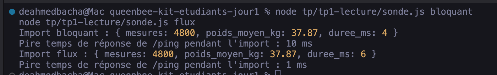
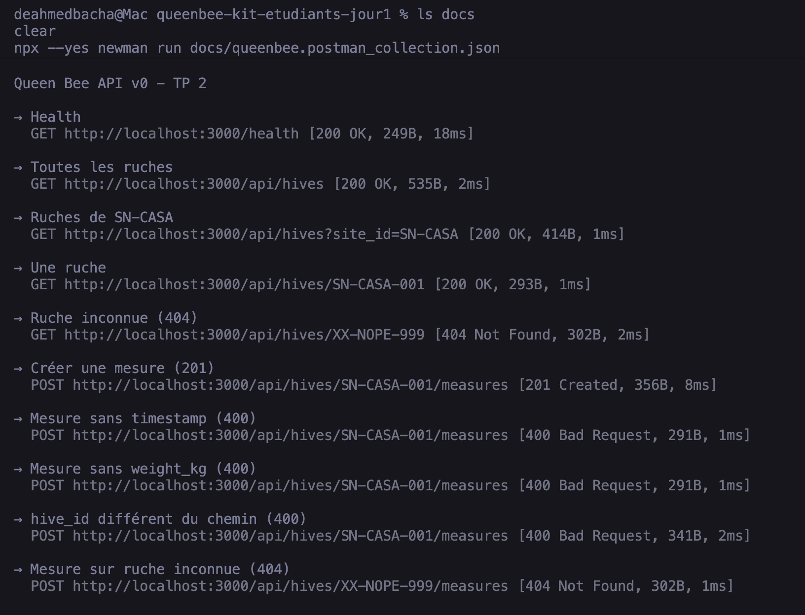
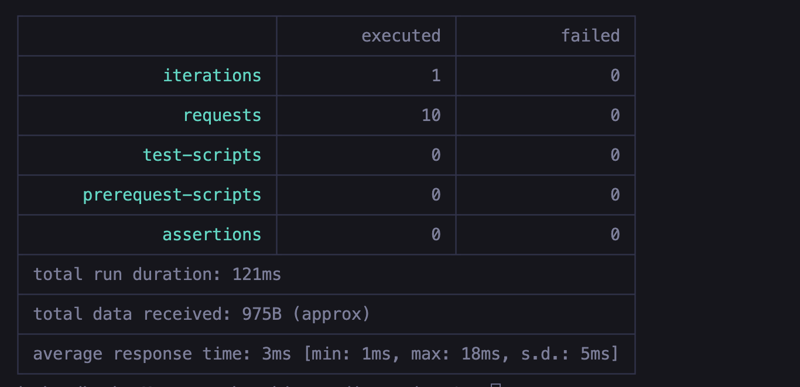
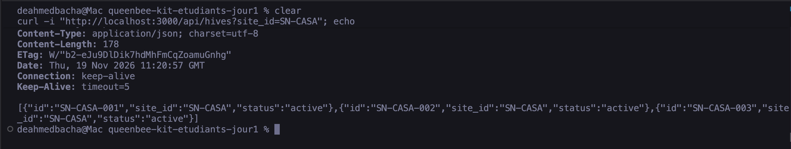
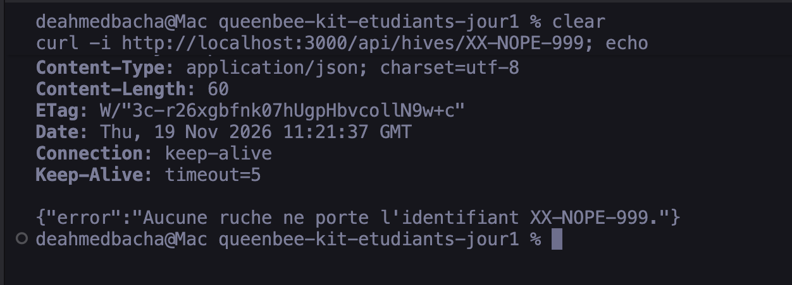
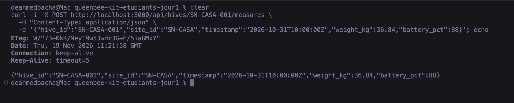

# Queen Bee : API v0

Lancement de l'API : `npm run dev`, puis elle répond sur `http://localhost:3000`.

## TP 1 : lire les mesures sans bloquer

Les deux routes renvoient les mêmes valeurs : 144 000 mesures et 38,74 kg avec le fichier de 30 jours, 4 800 mesures et 37,87 kg avec celui d'une journée.

| Fichier | Lecture | Durée de l'import (ms) | Pire temps de /ping (ms) |
| --- | --- | --- | --- |
| 1 jour | bloquante | 4 | 10 |
| 1 jour | en flux | 6 | 1 |
| 30 jours | bloquante | 115 | 111 |
| 30 jours | en flux | 103 | 2 |

**1. Pourquoi /ping attend-il pendant l'import bloquant ?**
Node.js exécute le JavaScript sur un seul fil. `readFileSync` puis la boucle de `JSON.parse` l'occupent jusqu'à la fin de l'import : la boucle d'événements ne peut traiter aucune autre requête, donc `/ping` attend presque toute la durée de l'import (111 ms pour 115 ms).

**2. La lecture en flux est-elle plus rapide ? Sinon, qu'apporte-t-elle ?**
Pas vraiment : le travail d'analyse est le même et les durées sont proches (103 ms contre 115 ms). Elle apporte la réactivité : entre deux morceaux du fichier, la boucle d'événements reprend la main et répond aux autres requêtes (2 ms au pire pour `/ping`). Le fichier n'est pas non plus chargé en entier en mémoire.

**3. Pourquoi l'effet est-il presque invisible avec le fichier d'une journée ?**
L'import d'une journée ne bloque que 4 ms, moins que l'intervalle de 10 ms entre deux `/ping` et du même ordre qu'une requête normale. Le blocage existe toujours, mais il est trop court pour se voir ; il grandit avec la taille du fichier.

### Captures d'exécution

Fichier de 30 jours, lecture bloquante puis en flux :

Serveur relancé sans argument, sur le fichier d'une journée :

Fichier d'une journée, lecture bloquante puis en flux :

## TP 2 : premières routes en mémoire

| Route | Comportement | Codes |
| --- | --- | --- |
| `GET /health` | Répond `{ "status": "ok" }` | 200 |
| `GET /api/hives` | Toutes les ruches ; avec `?site_id=SN-CASA`, seulement celles de ce site | 200 |
| `GET /api/hives/:id` | La ruche demandée | 200 ; 404 si elle n'existe pas |
| `POST /api/hives/:id/measures` | Enregistre la mesure du corps et la renvoie | 201 ; 400 si `timestamp` ou `weight_kg` manque, ou si `hive_id` diffère du chemin ; 404 si la ruche n'existe pas |

**Journalisation :** nous avons gardé notre intergiciel `requestLogger` plutôt que `morgan("dev")` : il donne la même information (méthode, URL, statut, durée), ajoute la date et ne dépend d'aucun paquet.

**Collection de requêtes :** `docs/queenbee.postman_collection.json`, une requête par route, cas d'erreur compris, sans jeton ni mot de passe. Elle s'importe dans Postman ou se lance en ligne de commande avec `npx newman run docs/queenbee.postman_collection.json`.

### Captures d'exécution

Exécution de la collection : chaque requête renvoie le code attendu.

Filtre par site : seules les ruches de SN-CASA.

Ruche inconnue : 404.

Création d'une mesure : 201.

Journal du serveur : une ligne par requête.

## TP 3 : le contrat de l'API, puis le code

Le contrat de toutes les routes est dans [`docs/api.md`](docs/api.md). Toutes les erreurs suivent la RFC 9457 (`Content-Type: application/problem+json`), grâce à `sendProblem` (`src/utils/problem.js`) ; une route inconnue et un JSON mal formé passent par `notFoundHandler` et `errorHandler` (`src/middlewares/errorHandler.js`).

| Route | Comportement | Codes |
| --- | --- | --- |
| `GET /api/hives/:id/measures` | Mesures de la plus récente à la plus ancienne ; `limit` de 1 à 500 (50 par défaut), `offset` ≥ 0 (0 par défaut) ; réponse `{ items, limit, offset }` | 200 ; 400 si un paramètre est invalide ; 404 |
| `GET /api/hives/:id/inspections` | Inspections de la ruche, la plus récente d'abord | 200 ; 404 |
| `POST /api/hives/:id/inspections` | Crée une inspection (`id` UUID choisi par l'application mobile) | 201 ; 400 ; 404 ; 409 si l'`id` existe déjà |

**Choix :** une inspection dont l'`id` existe déjà renvoie 409. L'UUID vient du téléphone : un même `id` reçu deux fois signale une synchronisation rejouée, pas une nouvelle inspection.

### Captures d'exécution

Exécution de la collection complète (26 requêtes) :

`limit` invalide : 400 au format RFC 9457.

La page `offset=50` ne répète aucune mesure de la première page.

Route inconnue : 404 au format RFC 9457, sans page HTML.

JSON mal formé : 400 au format RFC 9457.

Création d'une inspection : 201.

