# Queen Bee : API v0

Lancement de l'API : `npm run dev`, puis elle répond sur `http://localhost:3000`.

CE TRAVAIL EST FAITE PAR :
- Djamel Eddine AHMED BACHA
- Yaya Mohamedhen

## TP 1 : lire les mesures sans bloquer

Les deux routes renvoient les mêmes valeurs : 144 000 mesures et 38,74 kg avec le fichier de 30 jours, 4 800 mesures et 37,87 kg avec celui d'une journée.

| Fichier | Lecture | Durée de l'import (ms) | Pire temps de /ping (ms) |
| --- | --- | --- | --- |
| 1 jour | bloquante | 4 | 10 |
| 1 jour | en flux | 6 | 1 |
| 30 jours | bloquante | 115 | 111 |
| 30 jours | en flux | 103 | 2 |

**1. Pourquoi /ping attend-il pendant l'import bloquant ?**
Node.js exécute le JavaScript sur un seul fil. `readFileSync` puis la boucle de `JSON.parse` l'occupent jusqu'à la fin de l'import : la boucle d'événements ne peut traiter aucune autre requête, donc `/ping` attend presque toute la durée de l'import (111 ms pour 115 ms).

**2. La lecture en flux est-elle plus rapide ? Sinon, qu'apporte-t-elle ?**
Pas vraiment : le travail d'analyse est le même et les durées sont proches (103 ms contre 115 ms). Elle apporte la réactivité : entre deux morceaux du fichier, la boucle d'événements reprend la main et répond aux autres requêtes (2 ms au pire pour `/ping`). Le fichier n'est pas non plus chargé en entier en mémoire.

**3. Pourquoi l'effet est-il presque invisible avec le fichier d'une journée ?**
L'import d'une journée ne bloque que 4 ms, moins que l'intervalle de 10 ms entre deux `/ping` et du même ordre qu'une requête normale. Le blocage existe toujours, mais il est trop court pour se voir ; il grandit avec la taille du fichier.

### Captures d'exécution

Fichier de 30 jours, lecture bloquante puis en flux :

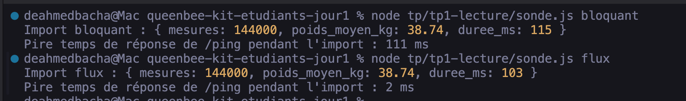

Serveur relancé sans argument, sur le fichier d'une journée :


Fichier d'une journée, lecture bloquante puis en flux :


## TP 2 : premières routes en mémoire

| Route | Comportement | Codes |
| --- | --- | --- |
| `GET /health` | Répond `{ "status": "ok" }` | 200 |
| `GET /api/hives` | Toutes les ruches ; avec `?site_id=SN-CASA`, seulement celles de ce site | 200 |
| `GET /api/hives/:id` | La ruche demandée | 200 ; 404 si elle n'existe pas |
| `POST /api/hives/:id/measures` | Enregistre la mesure du corps et la renvoie | 201 ; 400 si `timestamp` ou `weight_kg` manque, ou si `hive_id` diffère du chemin ; 404 si la ruche n'existe pas |

**Journalisation :** nous avons gardé notre intergiciel `requestLogger` plutôt que `morgan("dev")` : il donne la même information (méthode, URL, statut, durée), ajoute la date et ne dépend d'aucun paquet.

**Collection de requêtes :** `docs/queenbee.postman_collection.json`, une requête par route, cas d'erreur compris, sans jeton ni mot de passe. Elle s'importe dans Postman ou se lance en ligne de commande avec `npx newman run docs/queenbee.postman_collection.json`.

### Captures d'exécution

Exécution de la collection : chaque requête renvoie le code attendu.


Filtre par site : seules les ruches de SN-CASA.


Ruche inconnue : 404.


Création d'une mesure : 201.


Journal du serveur : une ligne par requête.

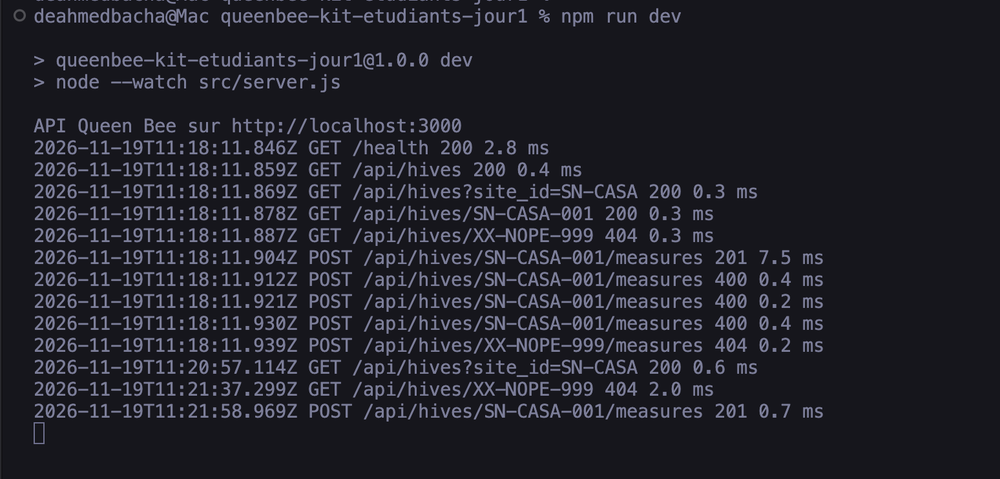

## TP 3 : le contrat de l'API, puis le code

Le contrat de toutes les routes est dans [`docs/api.md`](docs/api.md). Toutes les erreurs suivent la RFC 9457 (`Content-Type: application/problem+json`), grâce à `sendProblem` (`src/utils/problem.js`) ; une route inconnue et un JSON mal formé passent par `notFoundHandler` et `errorHandler` (`src/middlewares/errorHandler.js`).

| Route | Comportement | Codes |
| --- | --- | --- |
| `GET /api/hives/:id/measures` | Mesures de la plus récente à la plus ancienne ; `limit` de 1 à 500 (50 par défaut), `offset` ≥ 0 (0 par défaut) ; réponse `{ items, limit, offset }` | 200 ; 400 si un paramètre est invalide ; 404 |
| `GET /api/hives/:id/inspections` | Inspections de la ruche, la plus récente d'abord | 200 ; 404 |
| `POST /api/hives/:id/inspections` | Crée une inspection (`id` UUID choisi par l'application mobile) | 201 ; 400 ; 404 ; 409 si l'`id` existe déjà |

**Choix :** une inspection dont l'`id` existe déjà renvoie 409. L'UUID vient du téléphone : un même `id` reçu deux fois signale une synchronisation rejouée, pas une nouvelle inspection.

### Captures d'exécution

Exécution de la collection complète (26 requêtes) :

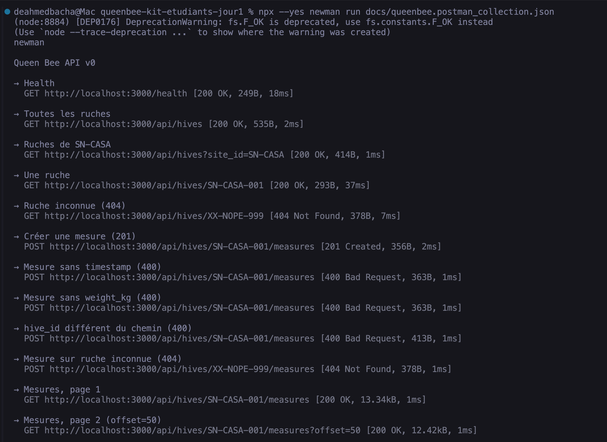

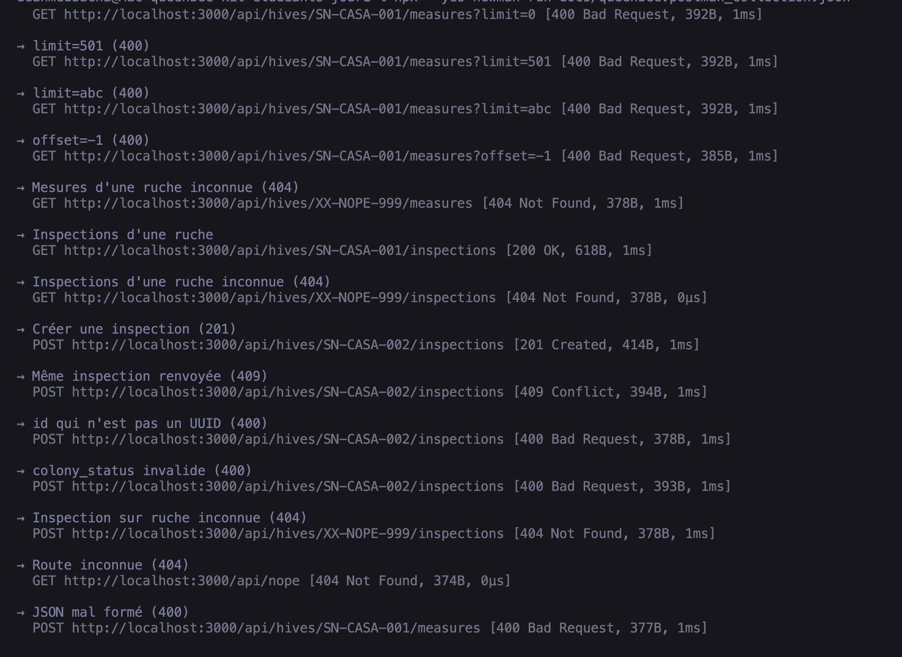

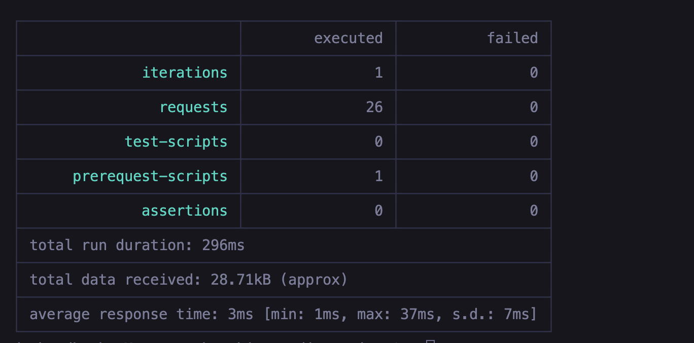

`limit` invalide : 400 au format RFC 9457.

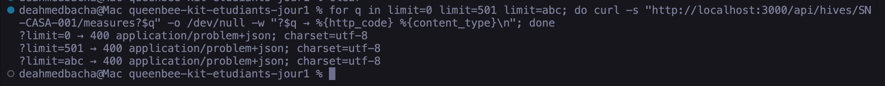

La page `offset=50` ne répète aucune mesure de la première page.

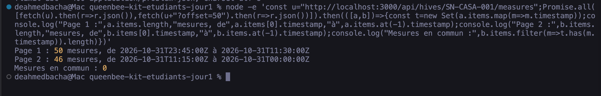

Route inconnue : 404 au format RFC 9457, sans page HTML.

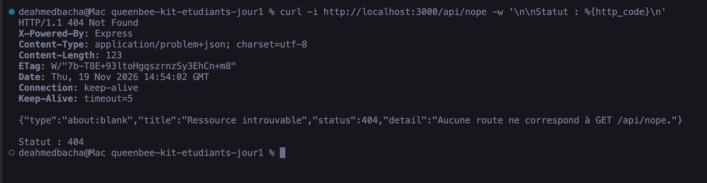

JSON mal formé : 400 au format RFC 9457.

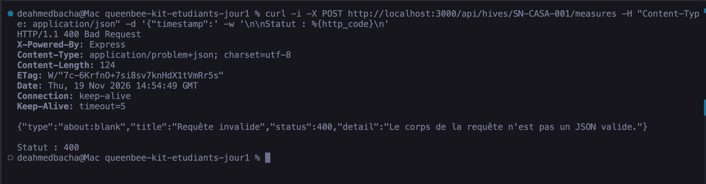

Création d'une inspection : 201.

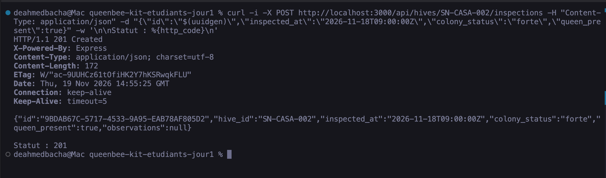


## TP 4 : passage en couches

Le code est organisé en couches, sans changement de comportement : la collection donne les mêmes 26 réponses avant et après.

```
src/
  app.js                          crée l'application et branche les couches
  server.js                       démarre le serveur (app.listen)
  config.js                       lit PORT et NODE_ENV ; une valeur invalide arrête le démarrage
  errors.js                       NotFoundError, ValidationError, ConflictError
  routes/hives/hives.router.js    URL et verbes
  controllers/hives.controller.js lit la requête, choisit la réponse
  services/                       règles métier (ruches, mesures, inspections)
  repositories/memory/            données en mémoire
  middlewares/                    requestLogger.js, errorHandler.js
  utils/problem.js                sendProblem, format RFC 9457
test/
  measures.service.test.js
```

Chaque service est une fabrique qui reçoit ses dépendances, par exemple `createMeasuresService({ hivesService, measuresRepository })`. Les services lèvent des erreurs métier ; `errorHandler` les traduit en 400, 404 ou 409. Aucun contrôleur n'importe un repository.

Lancement : `cp .env.example .env`, puis `npm run dev`. Tests : `npm test`.


## TP 5 : brancher PostgreSQL

L'API lit et écrit désormais dans la base PostgreSQL (`STORAGE=postgres` par défaut) via un pool de connexions (`src/db.js`) et les trois repositories de `src/repositories/postgres/`. Le convertisseur `pg.types.setTypeParser(1700, Number)` garantit que les colonnes `NUMERIC` (`weight_kg`, températures, score acoustique) sont renvoyées en nombres JSON. Les services, contrôleurs et routes restent strictement inchangés (`git diff jour1-fin --stat -- src/services src/controllers src/routes` est vide).

### Insertion en masse (`scripts/import-measures.js`)

| Mode d'insertion | Mesures insérées | Requêtes `INSERT` | Durée (ms) |
| --- | --- | --- | --- |
| Ligne à ligne (`ligne --vider`) | 4 800 | 4 800 (hors transaction) | 985 |
| Par lot (`lot --vider`) | 4 800 | 5 lots de 1 000 max (1 transaction) | 180 |

**1. Quel temps obtenez-vous dans chaque mode ? D'où vient l'écart ?**
Nous obtenons **985 ms** en insertion ligne à ligne contre **180 ms** en insertion par lot (plus de 5 fois plus rapide). En mode ligne à ligne, PostgreSQL effectue 4 800 allers-retours réseau et valide 4 800 transactions implicites sur disque (`fsync`), alors que le mode par lot n'envoie que 5 requêtes `INSERT` groupées et ne valide sur disque qu'une seule fois lors du `COMMIT`.

**2. Si la 2 001e mesure provoquait une erreur, que resterait-il en base dans chaque mode ?**
En mode **ligne à ligne**, chaque `INSERT` est validé immédiatement : les **2 000 premières mesures** resteraient enregistrées en base (base à moitié remplie). En mode **par lot**, le bloc `catch` exécute `ROLLBACK` sur la transaction unique : **0 mesure** de l'import ne resterait en base.

**3. Pourquoi la transaction emprunte-t-elle une connexion avec `pool.connect()` au lieu d'appeler `pool.query()` ?**
`pool.query()` peut répartir chaque requête sur une connexion différente du pool, ce qui briserait la transaction SQL. `pool.connect()` réserve une seule et même connexion dédiée (`client`) du `BEGIN` jusqu'au `COMMIT` ou `ROLLBACK`.

**4. Que se passerait-il si `client.release()` n'était pas dans le `finally`, et qu'une erreur survenait dix fois de suite ?**
Lors d'une erreur, la connexion empruntée ne serait jamais rendue au pool. Après dix erreurs consécutives (`DB_POOL_MAX=10`), les 10 connexions du pool seraient épuisées et toute nouvelle requête resterait bloquée avant d'échouer au bout de `connectionTimeoutMillis` (5 secondes).

### Captures d'exécution

Vérification de la base PostgreSQL (400 ruches, 1 146 240 mesures, 1 194 inspections) et démarrage du serveur :

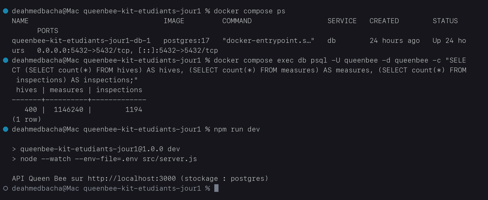

Lectures en base (`/api/hives`, filtre `?site_id=SN-CASA`, mesures paginées avec `weight_kg` numérique et inspections) :

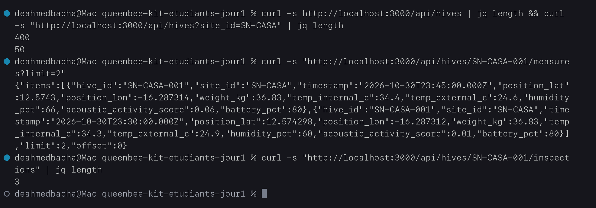

Tentative d'injection SQL neutralisée par les requêtes paramétrées et vérification que les couches `services`, `controllers` et `routes` sont intactes :

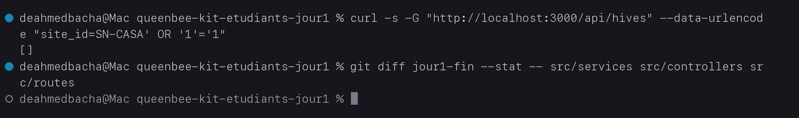

Comparaison de l'import en masse ligne à ligne (985 ms) et par lot (180 ms) :

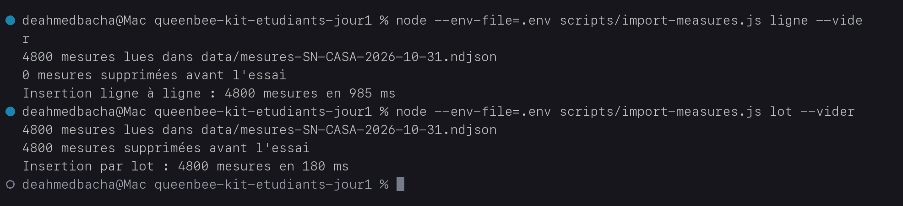


## TP 6 : validation et erreurs

Toutes les entrées (`req.body` et `req.query`) passent désormais par l'intergiciel `validate` (`src/middlewares/validate.js`) appuyé sur les schémas Joi (`src/validators/schemas.js`) et les messages en français (`src/validators/messages.js`), avec `abortEarly: false` pour remonter toutes les erreurs de validation en une seule réponse. Les données converties et complétées par défaut sont rangées dans `req.validated`.

Les erreurs métier héritent de `AppError(message, status)` (`src/errors.js`). L'intergiciel central `errorHandler` (`src/middlewares/errorHandler.js`) traduit :
- toute instance de `AppError` vers son statut (`400`, `404`, `409`) ;
- `entity.parse.failed` en `400` et `entity.too.large` (corps > 1 Mo) en `413` ;
- le code PostgreSQL `23505` (doublon de clé primaire/unique) en `409` (« Cette ressource existe déjà. ») et `23503` / `23514` / `22P02` en `400`, sans jamais divulguer de détail SQL ni de pile d'exécution dans la réponse RFC 9457.

### Captures d'exécution

Validation Joi des mesures (cumul des erreurs de plages physiques, champs obligatoires, paramètre `limit=abc`) :

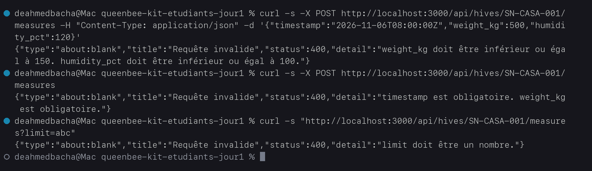

Traduction du doublon PostgreSQL (`23505` $\rightarrow$ `409`), rejet d'un champ non déclaré (`author_id`) et d'une date d'inspection dans le futur (`2099`) :

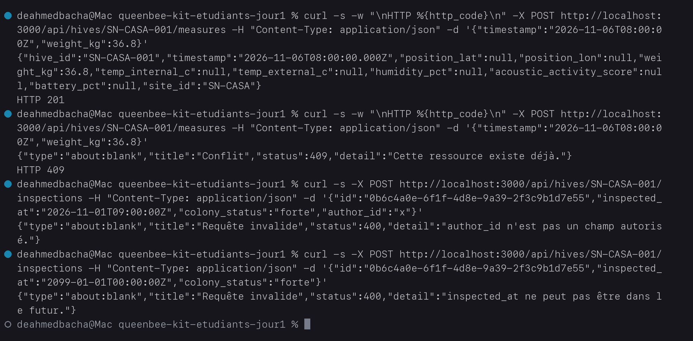

Exécution des tests unitaires (`test/measures.service.test.js` et `test/validators.test.js`) :

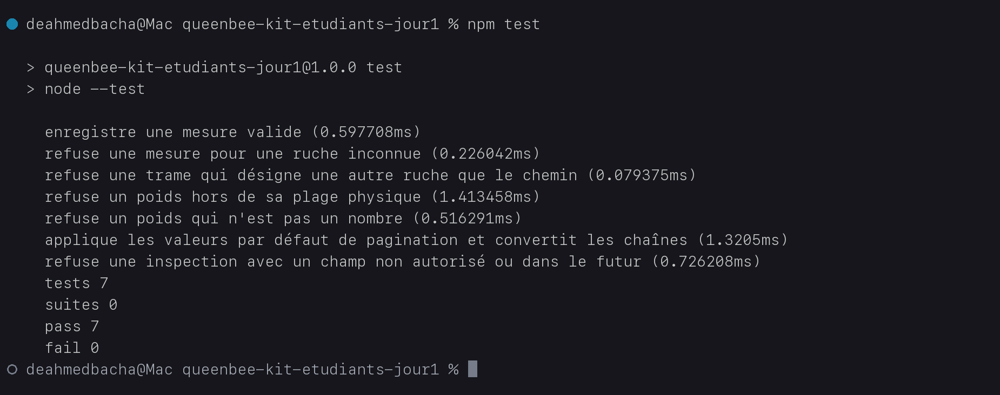
