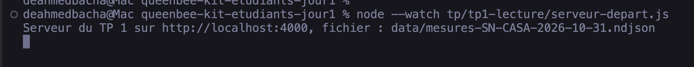

# Queen Bee : API v0

## TP 1 : lire les mesures sans bloquer

Les deux routes renvoient les mêmes valeurs : 144 000 mesures et 38,74 kg avec le fichier de 30 jours, 4 800 mesures et 37,87 kg avec celui d'une journée.

| Fichier | Lecture | Durée de l'import (ms) | Pire temps de /ping (ms) |
| --- | --- | --- | --- |
| 1 jour | bloquante | 4 | 10 |
| 1 jour | en flux | 6 | 1 |
| 30 jours | bloquante | 115 | 111 |
| 30 jours | en flux | 103 | 2 |

**1. Pourquoi /ping attend-il pendant l'import bloquant ?**
Node.js exécute le JavaScript sur un seul fil. `readFileSync` puis la boucle de `JSON.parse` l'occupent jusqu'à la fin de l'import : la boucle d'événements ne peut traiter aucune autre requête, donc `/ping` attend presque toute la durée de l'import (111 ms pour 115 ms).

**2. La lecture en flux est-elle plus rapide ? Sinon, qu'apporte-t-elle ?**
Pas vraiment : le travail d'analyse est le même et les durées sont proches (103 ms contre 115 ms). Elle apporte la réactivité : entre deux morceaux du fichier, la boucle d'événements reprend la main et répond aux autres requêtes (2 ms au pire pour `/ping`). Le fichier n'est pas non plus chargé en entier en mémoire.

**3. Pourquoi l'effet est-il presque invisible avec le fichier d'une journée ?**
L'import d'une journée ne bloque que 4 ms, moins que l'intervalle de 10 ms entre deux `/ping` et du même ordre qu'une requête normale. Le blocage existe toujours, mais il est trop court pour se voir ; il grandit avec la taille du fichier.

### Captures d'exécution

Fichier de 30 jours, lecture bloquante puis en flux :

Serveur relancé sans argument, sur le fichier d'une journée :

Fichier d'une journée, lecture bloquante puis en flux :

